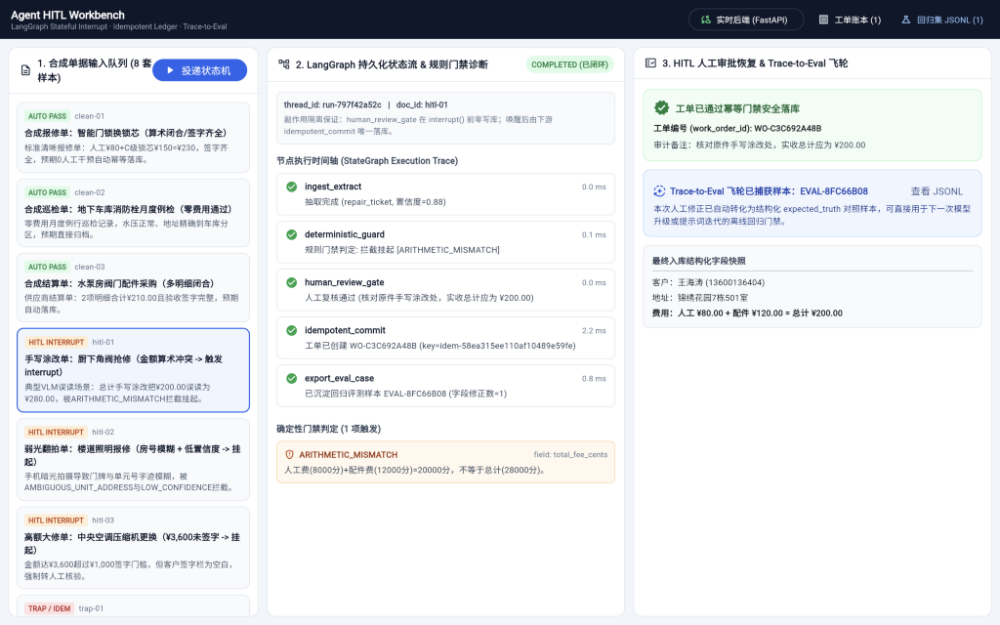
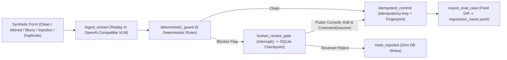

# Agent HITL Workbench (FDE & Applied AI Reference Brief)

[](https://github.com/mikehot/agent-hitl-workbench/actions/workflows/ci.yml) [](https://agent-hitl-workbench.pages.dev) [](LICENSE)  

[中文文档](README.md) | English | **[Interactive Zero-Install Live Demo](https://agent-hitl-workbench.pages.dev)**

A production-grade reference system for **Stateful Human-in-the-Loop (HITL) Approval, Idempotent Write-Back, and Trace-to-Eval Regression Flywheels**, built with **Python (`FastAPI` + `LangGraph 1.2` + `AsyncSqliteSaver`)** and **Flutter (`Web` / `macOS` / `Android`)**.

While our companion repository ([rag-knowledge-base](https://github.com/mikehot/rag-knowledge-base)) demonstrates **permission-aware read pipelines**, this workbench solves the harder half of enterprise AI integration: **how to safely wire probabilistic VLM/LLM extraction into transactional business tables with zero silent wrong writes, durable crash recovery across human review delays, and automated evaluation dataset generation.**



---

## 1. Discovery Brief: Why This Architecture Exists

When deploying AI agents over messy field-service forms, invoices, or maintenance tickets, naive prompt-to-API pipelines fail in three predictable ways:
1. **Silent Corrupt Writes**: Handwritten alterations (e.g., `¥80` labor + `¥120` parts misread as `¥280` total) or ambiguous unit numbers silently corrupt downstream ERP/work-order ledgers.
2. **Volatile Pause State & Duplicate Mutations**: Human approvals take minutes or hours. In-memory state vanishes on container restarts, while careless resumption re-triggers upstream side effects.
3. **Wasted Human Supervision**: Reviewers fix model mistakes every day in admin UIs, yet those corrections rarely flow back into a deterministic regression gate.

### Graph Topology (`LangGraph 1.2` + `AsyncSqliteSaver`)



---

## 2. Production Engineering Guarantees (Verified by Tests)

1. **Strict Side-Effect Isolation Around `interrupt()`** ([`graph.py`](backend/src/hitl_workbench/graph.py))
   - In `LangGraph`, `Command(resume=...)` re-executes the suspended node function from line 1. `human_review_gate` is kept strictly side-effect-free prior to `interrupt()`, while all mutations live in `idempotent_commit`. [`test_runtime_hitl.py`](backend/tests/test_runtime_hitl.py) asserts `gate_entry_count == 2` alongside `commit_execution_count == 1`.
2. **Pre-Resume Validation Avoiding Scratchpad Replay Pollution** ([`graph.py`](backend/src/hitl_workbench/graph.py))
   - *Real pitfall caught during integration testing*: raising a validation error *after* `interrupt()` in `LangGraph 1.2` leaves the invalid `resume` payload recorded in SQLite checkpoint writes, causing the next `Command(resume=...)` call to replay the stale invalid input. We enforce non-waivable invariants (arithmetic closure, injection sanitization) *before* invoking `Command(resume=...)`, returning HTTP `422` with zero checkpoint corruption.
3. **OS-Process Crash Durability** ([`scripts/e2e_smoke.sh`](scripts/e2e_smoke.sh))
   - Verified end-to-end by starting `uvicorn` process #1, pausing a ticket at `interrupt()`, `kill`-terminating process #1, booting a fresh `uvicorn` process #2 against the same SQLite database, and resuming to completion.
4. **Idempotent Ledger with Payload Fingerprint Conflict Detection** ([`ledger.py`](backend/src/hitl_workbench/ledger.py))
   - Deduplicates network retries and duplicate document submissions (`clean-01` -> `trap-02`) via `sha256(tenant_id:source_doc_key)`, incrementing `replay_hits` with zero duplicate rows while rejecting mutated payloads under the same key with HTTP `409`.
5. **Trace-to-Eval Flywheel & CLI Regression Gate** ([`eval_runner.py`](backend/src/hitl_workbench/eval_runner.py), [`cli_eval.py`](backend/src/hitl_workbench/cli_eval.py))
   - Every human field correction exports a structured `EvalRegressionCase` JSONL line (`raw_extraction` vs `expected_truth` + `field_diffs`). `python -m hitl_workbench.cli_eval` replays the exported suite and fails CI if `silent_wrong_writes > 0`.
6. **Cross-Platform Flutter Workbench (Zero-Token Sandbox + Live Backend)** ([`app/lib/`](app/lib/))
   - Responsive 3-pane desktop/Web layout (`>= 960px`) and 3-tab mobile layout (`< 960px`) preserving unsaved edits across viewport breakpoints. Ships with an embedded deterministic sandbox for instant zero-cost browser demos alongside live `FastAPI` connectivity.

---

## 3. Quick Start

```bash
# 1. Run backend lint, 28 pytest cases, and 6-stage OS-restart E2E smoke
cd backend && uv sync && uv run ruff check . && uv run pytest -q
cd .. && ./scripts/e2e_smoke.sh

# 2. Launch FastAPI backend (:8095) + Flutter Web/macOS console
(cd backend && uv run uvicorn hitl_workbench.main:app --host 127.0.0.1 --port 8095)
(cd app && flutter pub get && flutter run -d chrome)
```

To test against a live OpenAI-compatible VLM/LLM (e.g., local LM Studio with `reasoning_effort="none"`):

```bash
cd backend
WORKBENCH_MODE=live \
WORKBENCH_LLM_BASE_URL=http://127.0.0.1:1234/v1 \
WORKBENCH_LLM_MODEL_ID=qwen/qwen3.8-27b \
uv run uvicorn hitl_workbench.main:app --host 127.0.0.1 --port 8095
```

---

## 4. Honest Scope & Limitations

- **100% Synthetic Data**: All 8 bundled fixtures, names, unit addresses, and monetary figures are synthetic.
- **Single-Node SQLite Checkpointer by Default**: `AsyncSqliteSaver` (WAL mode) targets single-container deployments and reproducible local evaluation. Multi-replica horizontal scaling requires swapping in `AsyncPostgresSaver` and PostgreSQL unique constraints.
- **Correlated Misread Boundary**: Deterministic arithmetic guards catch single-field misreads (`80 + 120 != 280`), but cannot catch correlated misreads where two fields shift by equal amounts without an independent second-reader VLM pass.
