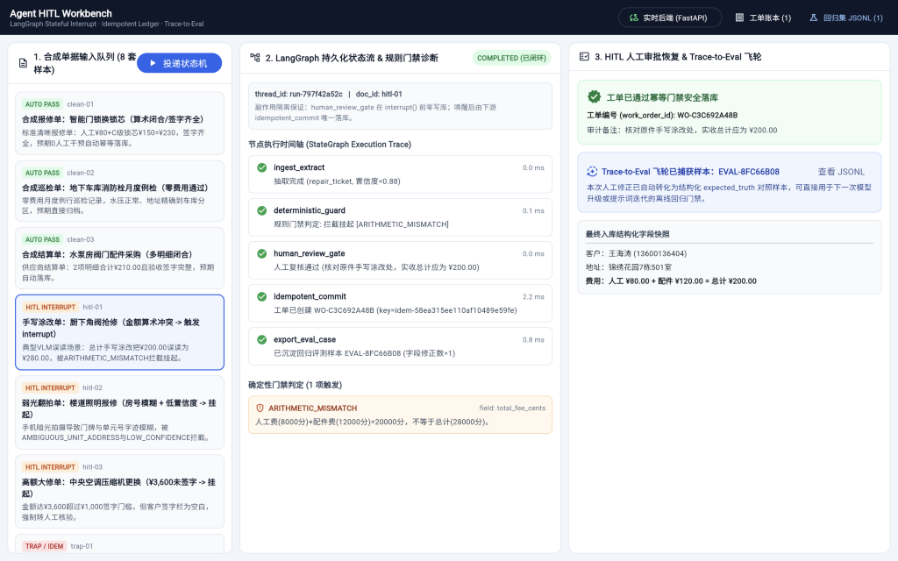
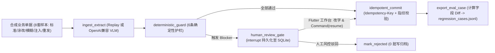

# Agent HITL Workbench

[](https://github.com/mikehot/agent-hitl-workbench/actions/workflows/ci.yml) [](https://agent-hitl-workbench.pages.dev) [](LICENSE)  

中文 | [English (FDE Discovery Brief)](README.en.md) | **[免登录在线交互体验 (Live Sandbox Demo)](https://agent-hitl-workbench.pages.dev)**

面向企业级受控落地的 **Stateful Human-in-the-Loop (HITL) 断点审批、幂等写回与 Trace-to-Eval 飞轮工作台**。

如果说企业知识库 RAG（[rag-knowledge-base](https://github.com/mikehot/rag-knowledge-base)）解决的是**「如何受控地读」**，本项目解决的就是企业把 AI Agent 接入真实业务数据库时最棘手的下半场：**「当视觉/语言模型遇到涂改单据、模糊地址或恶意提示词注入时，如何安全挂起状态机、跨进程崩溃持久化等待人工修正、幂等落库，并把每一次人工修正自动沉淀为离线回归评测集？」**



---

## 1. 业务痛点与架构定位

在物业报修、现场巡检、供应商结算单入库等真实流程中，纯自动化 Agent 面临三类致命生产事故：
1. **静默错写（Silent Wrong Writes）**：手写总价涂改（如人工 `¥80` + 配件 `¥120` 被视觉模型误读为总计 `¥280`）或暗光房号缺失，直接写入工单库会造成财务错账与派单串户。
2. **断点丢失与重复副作用**：人工复核往往跨越数分钟乃至数小时；若状态只存在内存里，服务重启即丢单；若恢复执行时节点重跑未做隔离，又会产生重复工单。
3. **人工纠错无法反哺评测**：运营每天都在后台替 AI 改错字，但这些宝贵的真实错题从未沉淀为自动化回归门禁，换模型或改 Prompt 时老 Bug 反复回潮。

### 状态图拓扑（`LangGraph 1.2` + `AsyncSqliteSaver`）



---

## 2. 核心工程机制与实测验证证据

| 工程机制 | 代码位置 | 解决的具体坑与自动化验证证据 |
| :--- | :--- | :--- |
| **`interrupt()` 副作用隔离** | [`graph.py`](backend/src/hitl_workbench/graph.py) / [`test_runtime_hitl.py`](backend/tests/test_runtime_hitl.py) | `LangGraph` 在调用 `Command(resume=...)` 时会**从挂起节点函数的第 1 行重新执行**。本工程将 `human_review_gate` 在 `interrupt()` 之前保持纯计算，所有写库动作下沉至独立 `idempotent_commit` 节点；单测实证单次审批闭环中 `gate_entry_count == 2` 而 `commit_execution_count == 1`。 |
| **Pre-Resume 预检防 Scratchpad 污染** | [`graph.py`](backend/src/hitl_workbench/graph.py) | **实测抓到的 `LangGraph 1.2` 底层坑**：若在 `interrupt()` *之后*抛业务校验异常，Checkpointer 已将错误的 `resume` 值写入 SQLite scratchpad，导致下次提交正确修正时仍回放旧脏值。修复方案是在进入 `Command(resume=...)` 前执行不可豁免规则（算术闭合/防注入）预检并返回 HTTP `422`，零污染 Checkpoint。 |
| **跨进程崩溃恢复（Durable Execution）** | [`e2e_smoke.sh`](scripts/e2e_smoke.sh) | 端到端冒烟脚本真实启动 `uvicorn` 进程 #1 触发挂起 → **`kill` 杀掉进程 #1** → 拉起全新 `uvicorn` 进程 #2 挂载同一 SQLite 文件完成审批唤醒与工单落库。 |
| **幂等键 + 载荷指纹防篡改（`409`）** | [`ledger.py`](backend/src/hitl_workbench/ledger.py) | 基于 `sha256(tenant_id:source_doc_key)` 生成 `Idempotency-Key`：同源重发（如 `clean-01` → `trap-02`）自动复用原工单并累加 `replay_hits`；若同单号篡改金额指纹则直接抛 `IdempotencyConflictError` 返回 HTTP `409`。 |
| **Trace-to-Eval 自动回归飞轮** | [`eval_runner.py`](backend/src/hitl_workbench/eval_runner.py) / [`cli_eval.py`](backend/src/hitl_workbench/cli_eval.py) | 人工修正任意字段通过后，自动生成带 `raw_extraction`、`expected_truth` 与 `field_diffs` 的 NDJSON 样本；CLI 离线回放器一票否决任何 `silent_wrong_writes > 0`。 |
| **跨端双模 Flutter 审批工作台** | [`app/lib/`](app/lib/) | 一套 Flutter 代码同时支持桌面/Web 三栏（`>= 960px`）与手机端三 Tab（`< 960px`），内置零网络/零 Token 确定性沙盒引擎，也可一键切换直连实时 `FastAPI` 服务。 |

---

## 3. 快速上手（Quick Start）

### 方式 A：运行全链路自动化校验（推荐先跑这条，约 10 秒）

```bash
# 1. Python 后端检查 + 28 项单元/集成测试 + 6 阶段杀进程重启 E2E 冒烟
cd backend
uv sync
uv run ruff check .
uv run pytest -q
cd ..
./scripts/e2e_smoke.sh
```

### 方式 B：启动本地实时前后端体验三栏审批工作台

```bash
# 终端 1：启动 FastAPI + LangGraph SQLite 服务（默认 replay 模式，零外部模型依赖）
cd backend
uv run uvicorn hitl_workbench.main:app --host 127.0.0.1 --port 8095

# 终端 2：启动 Flutter 桌面端或 Chrome Web 端（在右上角点「沙盒回放」可切换「连接实时 FastAPI」）
cd app
flutter pub get
flutter run -d chrome   # 或 flutter run -d macos
```

### 方式 C：对接本机 LM Studio 视觉/文本大模型（Live 模式）

```bash
# 先在 LM Studio 启动本地服务 (http://127.0.0.1:1234/v1) 并加载模型（代码默认传 reasoning_effort="none"）
cd backend
WORKBENCH_MODE=live \
WORKBENCH_LLM_BASE_URL=http://127.0.0.1:1234/v1 \
WORKBENCH_LLM_MODEL_ID=qwen/qwen3.8-27b \
uv run uvicorn hitl_workbench.main:app --host 127.0.0.1 --port 8095
```

### 方式 D：Docker Compose 一键启动后端

```bash
docker compose up --build -d
curl -s http://127.0.0.1:8095/healthz
```

---

## 4. 诚实边界与已知局限（Scope & Limitations）

- **100% 合成数据**：仓库内全部 8 套单据、姓名、门牌号与金额均为虚构合成样本，不含任何真实客户或物业隐私数据。
- **单机持久化与水平扩展边界**：默认使用 `AsyncSqliteSaver` + SQLite WAL，适合单实例容器部署与本地验收；多副本 K8s 并发部署需替换为 `AsyncPostgresSaver` 与 PostgreSQL 唯一约束表。
- **规则门禁的覆盖边界**：6 条确定性门禁可 100% 拦截算术不闭合、必填缺失、高额漏签与显式指令注入，但若模型把人工费和总计**同时同向误读**（例如同时少读 10 元使等式碰巧成立），单次抽取门禁无法自证，需结合多模态二次独立复核（参见姊妹项目中的高清二次查看机制）或人工抽检。

---

## 5. 文档导航

- [README.en.md](README.en.md) — 英文版架构与 FDE 交付说明
- [IMPLEMENTATION_PLAN.md](IMPLEMENTATION_PLAN.md) — P0–P4 阶段门禁规格与实测执行日志
- [docs/DEMO_SCRIPT.md](docs/DEMO_SCRIPT.md) — 90 秒有声演示视频分镜与旁白稿（中英双版）
